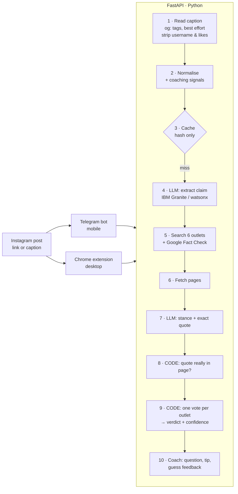

# Fact-Check Coach

> **A fact-checker that trains you to need it less.**

Young people get their news from Instagram, TikTok and X, and the debunk is usually buried in the comments. Fact-Check Coach is a Telegram bot and a Chrome extension that **asks you to guess before it tells you anything**, then shows what six named news outlets say, using quotes that have been checked word for word against the source.

Built for the IBM Responsible AI Hackathon challenge: *"Designing AI that makes us smarter, not more dependent."* Instagram is our primary test platform.

---

## How it works



```
User ──share/paste──▶ POST /check/start ──▶ claim + reflective question (NO verdict)
User ──guesses──────▶ POST /check/reveal ─▶ verdict, confidence, sources + verified quotes,
                                            guess feedback, one fact-checking tip
```

**The LLM never supplies facts.** It does two narrow reading jobs: pull the claim out of the post, and label each fetched article as *supports / contradicts / not mentioned* with an exact quote. Code then checks that quote against the real article text, and fixed rules decide the verdict.

### The six outlets

| Outlet | Type | Bias label* |
|---|---|---|
| Reuters Fact Check | Wire service | Center |
| AP Fact Check | Wire service | Left |
| AFP Fact Check | Fact-checker | Center |
| BBC Verify | Public broadcaster | Center |
| Snopes | Fact-checker | Lean Left |
| PolitiFact | Fact-checker | Lean Left |

\*Placeholders from AllSides. **Re-check each one on allsides.com before the pitch** and update `bias_checked` in [app/sources.yaml](app/sources.yaml). The list leans centre to centre-left, and we say so openly. `GET /sources` publishes the list.

**Why only six?** A short, named list is something a user can actually judge, and every piece of evidence is traceable to it. The cost is coverage: more claims come back `unverified`.

### Verdict rules (deterministic, in [app/verdict.py](app/verdict.py))

Each outlet gets **one vote**, so three Reuters articles count once. A published fact-check (Google ClaimReview) from a whitelisted outlet counts **2**.

1. Breaking news covered by fewer than 2 outlets → **developing**
2. Less than 2 weighted votes → **unverified** (one plain article is never enough)
3. Contradicting ≥ 2 with no support, or ≥ 3 and at least 2:1 → **false**
4. Supporting ≥ 2 with no contradiction, or ≥ 3 and at least 2:1 → **true**
5. Both sides present and ≥ 3 weighted votes in total → **misleading**
6. Otherwise → **unverified**

Confidence is `high` at ≥ 4 weighted votes, no opposition and ≥ 2 outlets; `medium` at ≥ 3 (or 2 with no opposition); otherwise `low`.

---

## Run it

### Quick start (offline, no keys)

```bash
make install      # Python 3.11 venv + dependencies
make test         # 137 tests, all offline in mock mode
make demo         # terminal walkthrough of the 4 Instagram cases (works with Wi-Fi off)
make run          # API on http://localhost:8000  (docs at /docs)
```

### With Docker

```bash
make docker-test  # build and run the test suite in a container
make docker-up    # API on http://localhost:8000
make docker-demo  # offline demo inside the container
make docker-bot   # API + Telegram bot (needs TELEGRAM_BOT_TOKEN in .env)
make docker-down
```

The image includes the fixtures, so it runs in mock mode with no keys. Put real keys in `.env` (copy [.env.example](.env.example)) to switch providers.

### Real providers

| Setting | Values |
|---|---|
| `LLM_PROVIDER` | `watsonx` (IBM Granite, preferred), `anthropic` (fallback), `mock` |
| `SEARCH_PROVIDER` | `google_factcheck`, `tavily`, `brave`, `mock`. Tavily/Brave also query Google Fact Check if `GOOGLE_FACTCHECK_API_KEY` is set. |

### Telegram bot

1. Create a bot with [@BotFather](https://t.me/BotFather) and put the token in `.env` as `TELEGRAM_BOT_TOKEN`.
2. `make run` in one terminal, `make bot` in another (or `make docker-bot`).
3. On your phone: Instagram post → **Share** → Telegram → your bot. Or paste the caption.

If Instagram blocks the link preview (it often does for logged-out requests), the bot asks you to paste the caption.

### Chrome extension

1. `chrome://extensions` → turn on **Developer mode** → **Load unpacked** → choose the [extension/](extension/) folder.
2. Highlight a caption on instagram.com → right-click → **Check with Fact-Check Coach**.
3. On an Instagram post page, open the extension popup and click **Check this Instagram post**.

The API address is configurable under *Settings* in the popup (default `http://localhost:8000`).

### API

| Endpoint | Purpose |
|---|---|
| `GET /health` | Status, active providers, counters (checks, cache hits, rejected quotes) |
| `GET /sources` | The six outlets with bias labels |
| `POST /check/start` | `{text, url?, client}` → claim + question. **Never** includes the verdict. |
| `POST /check/reveal` | `{check_id, guess}` → full result. 404 unknown id, 410 expired (15 min). |
| `POST /check` | One-shot for scripts (front ends must use start → reveal) |

---

## Responsible AI

| Jury criterion | What we built |
|---|---|
| **People stay engaged and in control** | Guess-first flow: `/check/start` cannot return a verdict (tested). A reflective question chosen from the post's signals, then guess feedback and one transferable tip. |
| **Traceable sources** | Every verdict lists outlet, link and exact quote. Only six named outlets count. |
| **Explainable reasoning** | Published, deterministic rules with named constants. The LLM only reads. |
| **Visible uncertainty** | `unverified` and `developing` are normal answers. Confidence is always shown. The disclaimer says "check them yourself". |
| **Safeguards against hallucinated references** | Every LLM quote is matched against the fetched page (normalised, fuzzy ≥ 90). A fake quote is thrown out, its label is downgraded and it is counted in `rejected_quotes`, which the user can see. Tested with a planted hallucination. |
| **Unsupported claims** | Opinions are detected and not "fact-checked". |
| **Fairness** | Named whitelist with public bias labels, one vote per outlet, and an openly stated lean. |
| **Privacy** | No post text, usernames or chat IDs are stored or logged (tested). The cache key is a SHA-256 hash. Instagram usernames and like counts are stripped before processing. No login, no scraping libraries, no comments or profiles. API keys are kept out of logs. |
| **Resource use** | Cache by post hash and claim hash, so a repeat check makes zero LLM calls (tested). Small model at low effort, narrow tasks, capped source text, 12-second fetch budget. |

## Honesty: what works vs. what's a concept

**Works today:** Telegram bot, Chrome extension, Instagram captions (best effort, with a paste fallback), 6-outlet search via Google Fact Check + Tavily/Brave, quote verification, verdict rules, coaching, cache, offline demo, Docker, 137 tests.

**Not verified yet:** the watsonx, Anthropic, Google Fact Check, Tavily and Brave integrations are written and unit-tested against mocked HTTP. They have not yet been run with live keys.

**Fixtures are synthetic.** The pages under `tests/fixtures/sources/` are labelled `[FIXTURE]` and are not real articles. Before the pitch, run the real demo claims live once and save the results as fixtures.

**Concepts / next:**
- Reel audio transcription and on-screen text (OCR). Today we read the caption only.
- Adaptive tips that fade as the user improves.
- Follow-up when a `developing` story resolves.
- WhatsApp bot.
- Evaluation on labelled datasets (LIAR, FEVER, FakeNewsNet).
- More outlets, including regional and non-English fact-checkers.

## Limitations

- **Coverage:** six English-language, mostly US/UK outlets. Local or non-English claims will often be `unverified`.
- **Breaking news:** usually `developing` until at least two outlets report it, by design.
- **Instagram access:** logged-out previews are often blocked, so the user may need to paste the caption.
- **Text only:** images and video are not analysed.
- **Bias labels** are third-party ratings (AllSides) and are themselves contested.

## Project layout

```
app/        API, pipeline, verdict rules, quote verifier, coach, providers (llm/)
bot/        Telegram bot
extension/  Chrome extension (MV3, no build step)
scripts/    demo.py
tests/      137 tests + Instagram and source fixtures
```
