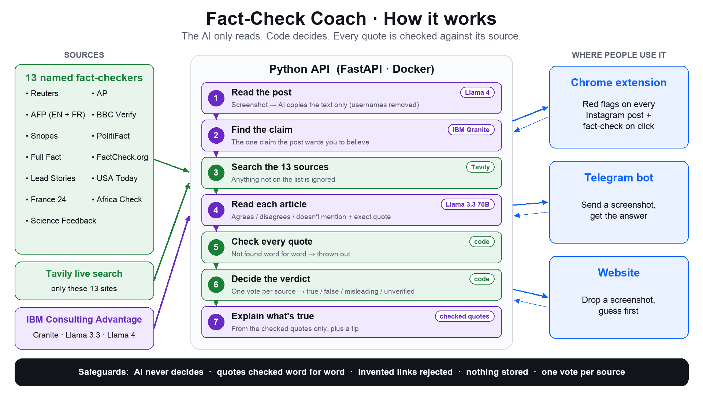

# Fact-Check Coach

**Send it an Instagram post: you guess first, then it shows what 13 trusted fact-checkers say, and what's actually true.**



📊 **Pitch deck:** [docs/rethink_bot-pitch.pptx](docs/rethink_bot-pitch.pptx)

## Use it

| Where | How |
|---|---|
| 🧩 Chrome | Red flags on every Instagram post. Click to fact-check it. |
| 💬 Telegram | Send a screenshot to the bot, get the answer. |
| 🌐 Website | Drop a screenshot at http://localhost:8000 |

## Run it

```bash
make install
cp .env.example .env    # add ICA_API_KEY, TAVILY_API_KEY, TELEGRAM_BOT_TOKEN
make run                # website + API
make bot                # Telegram bot
```

Chrome: `chrome://extensions` → Developer mode → **Load unpacked** → `extension/`

No keys? `make demo` (offline) · `make test` (180 tests)

## Why trust it

- The AI only **reads**. Fixed rules decide.
- Every quote is **checked word for word**. Made-up ones are thrown out.
- **Nothing is stored.**

## Results

50 real Instagram posts: **67% of misinformation caught, 0 false posts called true.**

## Sources

Reuters · AP · AFP · BBC Verify · Snopes · PolitiFact · Full Fact · FactCheck.org · Lead Stories · USA Today · France 24 · Africa Check · Science Feedback
