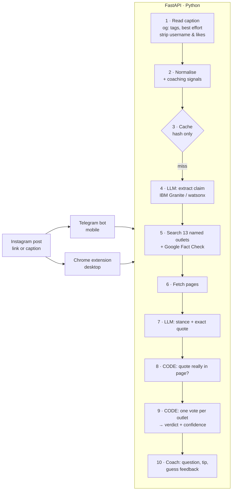

# Fact-Check Coach

> **A fact-checker that trains you to need it less.**

Young people get their news from Instagram, TikTok and X, and the debunk is usually buried in the comments. Fact-Check Coach is a Telegram bot and a Chrome extension that **asks you to guess before it tells you anything**, then shows what 13 named fact-checkers and newsrooms say, using quotes that have been checked word for word against the source.

Built for the IBM Responsible AI Hackathon challenge: *"Designing AI that makes us smarter, not more dependent."* Instagram is our primary test platform.

---

## How it works



```
User ──share/paste──▶ POST /check/start ──▶ claim + reflective question (NO verdict)
User ──guesses──────▶ POST /check/reveal ─▶ verdict, confidence, sources + verified quotes,
                                            guess feedback, one fact-checking tip
```

**The LLM never supplies facts.** It does two narrow reading jobs: pull the claim out of the post, and label each fetched article as *supports / contradicts / not mentioned* with an exact quote. Code then checks that quote against the real article text, and fixed rules decide the verdict.

### The 13 outlets

| Outlet | Type | Bias label (AllSides)* |
|---|---|---|
| Reuters Fact Check | Wire service | Center ✓ |
| AP Fact Check | Wire service | Left (unconfirmed) |
| AFP Fact Check (English + French) | Fact-checker | Center (unconfirmed) |
| BBC Verify | Public broadcaster | Center ✓ |
| Snopes | Fact-checker | Lean Left ✓ |
| PolitiFact | Fact-checker | Lean Left ✓ |
| Full Fact | Fact-checker (UK) | not checked yet |
| FactCheck.org | Fact-checker (US) | not checked yet |
| Lead Stories | Fact-checker (viral social posts) | not checked yet |
| USA Today Fact Check | Newspaper | not checked yet |
| France 24 Truth or Fake | Public broadcaster | not checked yet |
| Africa Check | Fact-checker | not checked yet |
| Science Feedback | Scientists (health, climate) | not checked yet |

\*✓ = seen on AllSides on 2026-10-24. Check the rest on allsides.com before the pitch and update [app/sources.yaml](app/sources.yaml); `GET /sources` publishes the list with each label's status.

**Why a named list?** Every piece of evidence is traceable to an outlet the user can judge. We started with six and grew to 13 after measuring: coverage was the main reason claims came back `unverified`. One vote per outlet still means no single newsroom decides.

### Models (IBM Consulting Advantage)

| Job | Model | Why |
|---|---|---|
| Pull the claim out of a post, sort comments | IBM Granite 4H Small | Short, structured tasks |
| Read each article: supports / contradicts / not mentioned + exact quote | Llama 3.3 70B (open weights) | On real AFP 5G debunks it found 4 of 4; Granite found 1 of 4 |
| Copy the text off screenshots | Llama 4 Maverick (open weights) | Exact transcription in our tests, about 3 s |
| Offline backup | Granite 4.1 8B via Ollama | No key, no internet |

### Verdict rules (deterministic, in [app/verdict.py](app/verdict.py))

Each outlet gets **one vote**, so three Reuters articles count once. A published fact-check (Google ClaimReview) from a whitelisted outlet counts **2**.

1. Breaking news covered by fewer than 2 outlets → **developing**
2. Less than 2 weighted votes → **unverified** (one plain article is never enough)
3. Contradicting ≥ 2 with no support, or ≥ 3 and at least 2:1 → **false**
4. Supporting ≥ 2 with no contradiction, or ≥ 3 and at least 2:1 → **true**
5. Both sides present and ≥ 3 weighted votes in total → **misleading**
6. Otherwise → **unverified**

Confidence is `high` at ≥ 4 weighted votes, no opposition and ≥ 2 outlets; `medium` at ≥ 3 (or 2 with no opposition); otherwise `low`.

---

### Screenshots

Much Instagram misinformation is a screenshot of a headline with no useful caption. Send the screenshot to the bot, upload it in the extension, or right-click an image on instagram.com.

A vision model **only transcribes** the visible text, with usernames and like counts removed. That text then goes through the same pipeline. The default is Llama 4 Maverick via ICA, which has open weights; `qwen2.5vl` via Ollama works offline. For an Instagram link, the post's own preview image is read too. Images are never stored or logged.

### Comment sections

The debunk is often buried in the comments, next to the misinformation. Paste the comments or send a screenshot (bot: `/comments`, or the *Check the comments too* button; extension: *Check comments* tab). Each comment is labelled:

- 💬 **Opinion**: can't be fact-checked
- ❔ **Question**
- 🚩 **Misinformation**: its claim is false according to the outlets
- ✅ **Backed by the outlets we checked**: often the buried debunk

Claims are always restated positively, with a flag for whether the comment *asserts* or *denies* them. "There's no evidence 5G makes you sick" therefore checks the same claim as the post (cache hit) and is correctly marked *backed*. Language models often get negation wrong, and this design removes that failure mode.

For posts on **our own demo account**, the real comment section is read through the official Instagram Graph API (`/comments/from-post`). It's never accessed with a password and never on other accounts, and usernames are never requested. See [credentials.md](credentials.md).

## Run it

### Quick start (offline, no keys)

```bash
make install      # Python 3.11 venv + dependencies
make test         # 163 tests, all offline in mock mode
make demo         # terminal walkthrough of the 4 Instagram cases (works with Wi-Fi off)
make run          # API on http://localhost:8000  (docs at /docs)
```

### With Docker

```bash
make docker-test  # build and run the test suite in a container
make docker-up    # API on http://localhost:8000
make docker-demo  # offline demo inside the container
make docker-bot   # API + Telegram bot (needs TELEGRAM_BOT_TOKEN in .env)
make docker-down
```

The image includes the fixtures, so it runs in mock mode with no keys. Put real keys in `.env` (copy [.env.example](.env.example)) to switch providers.

### Real providers

| Setting | Values |
|---|---|
| `LLM_PROVIDER` | `ica` (IBM Consulting Advantage API, default model `ibm/granite-4-h-small`), `ollama` (open-source Granite 4.1 8B on your own machine, no key, nothing leaves the laptop), `watsonx`, `anthropic`, `mock` |
| `SEARCH_PROVIDER` | `google_factcheck`, `tavily`, `brave`, `mock`. Tavily/Brave also query Google Fact Check if `GOOGLE_FACTCHECK_API_KEY` is set. |

### Telegram bot

1. Create a bot with [@BotFather](https://t.me/BotFather) and put the token in `.env` as `TELEGRAM_BOT_TOKEN`.
2. `make run` in one terminal, `make bot` in another (or `make docker-bot`).
3. On your phone: Instagram post → **Share** → Telegram → your bot. Or paste the caption.

If Instagram blocks the link preview (it often does for logged-out requests), the bot asks you to paste the caption.

### Chrome extension

1. `chrome://extensions` → turn on **Developer mode** → **Load unpacked** → choose the [extension/](extension/) folder.
2. Highlight a caption on instagram.com → right-click → **Check with Fact-Check Coach**.
3. On an Instagram post page, open the extension popup and click **Check this Instagram post**.

The API address is configurable under *Settings* in the popup (default `http://localhost:8000`).

### API

| Endpoint | Purpose |
|---|---|
| `GET /health` | Status, active providers, counters (checks, cache hits, rejected quotes) |
| `GET /sources` | The outlets with bias labels and their status |
| `POST /check/start` | `{text, url?, client}` → claim + question. **Never** includes the verdict. |
| `POST /check/reveal` | `{check_id, guess}` → full result. 404 unknown id, 410 expired (15 min). |
| `POST /check` | One-shot for scripts (front ends must use start → reveal) |
| `POST /check/start` with `image_base64` / `image_url` | Same flow from a screenshot (image URLs: Instagram/Facebook CDNs only) |
| `POST /comments/check` | `{text?, image_base64?}` → each comment labelled opinion / question / misinformation / backed |
| `POST /comments/from-post` | `{url}` → real comments of one of our demo account's posts (official Graph API) |

---

## Responsible AI

| Jury criterion | What we built |
|---|---|
| **People stay engaged and in control** | Guess-first flow: `/check/start` cannot return a verdict (tested). A reflective question chosen from the post's signals, then guess feedback and one transferable tip. |
| **Traceable sources** | Every verdict lists outlet, link and exact quote. Only the 13 named outlets count. |
| **Explainable reasoning** | Published, deterministic rules with named constants. The LLM only reads. |
| **Visible uncertainty** | `unverified` and `developing` are normal answers. Confidence is always shown. The disclaimer says "check them yourself". |
| **Safeguards against hallucinated references** | Every LLM quote is matched against the fetched page (normalised, fuzzy ≥ 90). A fake quote is thrown out, its label is downgraded and it is counted in `rejected_quotes`, which the user can see. Tested with a planted hallucination. |
| **Unsupported claims** | Opinions are detected and not "fact-checked", in posts and in comments. Misinformation in comments is flagged, and comments backed by the outlets are highlighted. |
| **Images** | Vision model is told to transcribe only (no interpretation). UI text and usernames are removed. Images are not stored. Image URLs are allowlisted to Instagram/Facebook CDNs. |
| **Fairness** | Named whitelist with public bias labels, one vote per outlet, and an openly stated lean. |
| **Privacy** | No post text, usernames or chat IDs are stored or logged (tested). The cache key is a SHA-256 hash. Instagram usernames and like counts are stripped before processing. No login, no scraping libraries, no comments or profiles. API keys are kept out of logs. |
| **Resource use** | Cache by post hash and claim hash, so a repeat check makes zero LLM calls (tested). Small model at low effort, narrow tasks, capped source text, 12-second fetch budget. |

## Honesty: what works vs. what's a concept

**Works today:** Telegram bot, Chrome extension (tested in Chromium), Instagram captions (best effort, with a paste fallback), **screenshot reading**, **comment-section checking**, official Graph API for the demo account, 6-outlet search via Google Fact Check + Tavily/Brave, quote verification, verdict rules, coaching, progress tracker, cache, offline demo, Docker, 163 tests.

**Verified with real models (24 Oct 2026):** on the four demo cases, IBM Granite 4H Small (via ICA), Llama 3.3 70B, Claude Haiku 5.5 (via ICA) and Granite 4.1 8B (local, via Ollama) all gave the expected verdicts, and every quote they returned passed verification. Gemma 4 also got every verdict right, with one lower confidence. `make check-providers` re-runs the key checks.

**Not verified yet:** the live search providers (Google Fact Check, Tavily, Brave) and the direct watsonx/Anthropic clients need keys we don't have yet. Reuters, AP and AFP block direct page fetches (401/403), so live runs rely on Tavily's page text for those three outlets.

**Fixtures are synthetic.** The pages under `tests/fixtures/sources/` are labelled `[FIXTURE]` and are not real articles. Before the pitch, run the real demo claims live once and save the results as fixtures.

**Concepts / next:**
- Reel audio transcription and video frames. Today we read a Reel's caption and preview image only.
- Adaptive tips that fade as the user improves.
- Follow-up when a `developing` story resolves.
- WhatsApp bot.
- Evaluation on labelled datasets (LIAR, FEVER, FakeNewsNet).
- More outlets, including regional and non-English fact-checkers.

## Limitations

- **Coverage:** 13 mostly English-language (plus French) Western outlets. Many local or non-English claims will be `unverified`.
- **Breaking news:** usually `developing` until at least two outlets report it, by design.
- **Instagram access:** logged-out previews are often blocked, so the user may need to paste the caption.
- **Images:** text in images is read; photos without text (e.g. a doctored picture) are not analysed. Video and audio are not analysed.
- **Comments of other accounts' posts** can't be read automatically (Instagram rule). Users paste or screenshot them.
- **Bias labels** are third-party ratings (AllSides) and are themselves contested.

## Project layout

```
app/        API, pipeline, verdict rules, quote verifier, coach, providers (llm/)
bot/        Telegram bot
extension/  Chrome extension (MV3, no build step)
scripts/    demo.py
tests/      163 tests + Instagram, image and source fixtures
```
